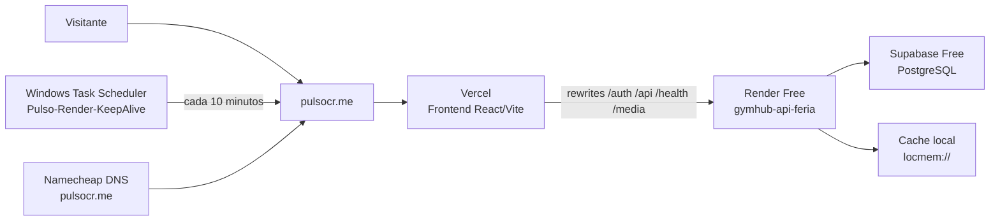

# Infraestructura De Feria

## Arquitectura Actual



## Componentes

| Componente | Servicio | Uso |
|---|---|---|
| Dominio y DNS | Namecheap | `pulsocr.me` y `www.pulsocr.me` |
| Frontend | Vercel | Aplicación React/Vite |
| Rewrites | [`frontend/vercel.json`](../frontend/vercel.json) | Enruta las rutas del frontend hacia Render |
| Backend | Render Free | Django, Gunicorn y Docker |
| Base de datos | Supabase Free | PostgreSQL mediante Session Pooler |
| Cache y tareas | Render local | `locmem://`, sin Redis/Celery persistentes |
| Keep-alive | Windows | Ping a `/health/ready/` cada 10 minutos |

## Flujo De Una Petición

1. El visitante abre `https://pulsocr.me`.
2. Vercel entrega el frontend.
3. Las rutas `/auth/*`, `/api/*`, `/health/*` y `/media/*` se reescriben hacia
   `https://gymhub-api-feria.onrender.com`.
4. Django consulta Supabase PostgreSQL cuando la operación lo requiere.
5. Render responde a través del mismo dominio público de Pulso.

## URLs Operativas

- Frontend: `https://pulsocr.me`
- API Render: `https://gymhub-api-feria.onrender.com`
- Health público: `https://pulsocr.me/health/ready/`
- Esquema API: `https://pulsocr.me/api/schema/`
- Dashboard Render: servicio `gymhub-api-feria`
- Proyecto Supabase: `GymApp`

## Secretos Y Archivos Locales

- Contraseña de Supabase: `.secrets/supabase-password.txt`
- La carpeta `.secrets/` está excluida por [`.gitignore`](../.gitignore).
- La contraseña nunca debe escribirse en documentación versionada, GitHub,
  capturas ni mensajes.
- El archivo [`render.yaml`](../render.yaml) declara `DATABASE_URL` como
  `sync: false`; el valor real se mantiene en las variables privadas de Render.

## Keep-Alive De Windows

La tarea `Pulso-Render-KeepAlive` se inicia al iniciar sesión en Windows y
ejecuta [`tools/keep-render-awake.ps1`](../tools/keep-render-awake.ps1).

- Intervalo: 10 minutos.
- Endpoint: `https://www.pulsocr.me/health/ready/`.
- Registro: `logs/render-keepalive.log`.
- Requiere que la PC esté encendida y conectada.
- Si la PC permanece apagada, Render puede entrar en suspensión.

Para consultar la tarea:

```powershell
Get-ScheduledTask -TaskName 'Pulso-Render-KeepAlive'
```

Para eliminarla:

```powershell
Unregister-ScheduledTask -TaskName 'Pulso-Render-KeepAlive' -Confirm:$false
```

## Limitaciones Conocidas

- Render Free puede suspender el servicio tras inactividad y la primera
  petición puede tardar aproximadamente 50 segundos.
- El keep-alive de Windows no funciona con la PC apagada.
- Vercel se conserva como respaldo de emergencia, pero el rewrite activo apunta
  a Render.
- Redis, Celery Worker y Celery Beat persistentes no forman parte del entorno
  gratuito de feria.
