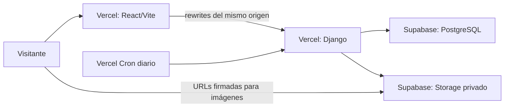

# Infraestructura de feria

## Arquitectura actual — 2026-11-18

| Componente | Servicio | Uso |
|---|---|---|
| Dominio y DNS | Namecheap | `pulsocr.me` y `www.pulsocr.me` |
| Frontend y API | Vercel Hobby | React/Vite y Django |
| Rewrites | [Configuración del frontend](../frontend/vercel.json) | API Vercel bajo el dominio público |
| Base de datos | Supabase Free | Transaction Pooler, SSL, pool local de 0–1 conexiones |
| Fotos, logos y QR de pago | Supabase Storage | Bucket privado `gymhub-media`, máximo 2 MB, firmas S3 v4 |
| Caché y tokens QR | PostgreSQL | Caché compartida y consumo transaccional del QR |
| Mantenimiento | Vercel Cron | Membresías, planes programados, inactividad y limpieza |
| IA | Django | Proveedor determinista |

## URLs

- Sitio: https://www.pulsocr.me
- API: https://proyectoappgym-backend.vercel.app
- Salud pública: https://www.pulsocr.me/health/ready/
- Documentación API: https://www.pulsocr.me/api/docs/

Render dejó de ser el destino de los rewrites. Su servicio y [Blueprint](../render.yaml)
se conservan como referencia del despliegue anterior. El keep-alive de Windows
ya no es necesario; su tarea debe permanecer deshabilitada.

## Validación

Se probaron login de administrador y cliente, perfiles, QR persistente, gráficas,
subida de foto por la API pública, lectura posterior, URL firmada y rechazo sin
firma. Los datos de prueba de fotos fueron retirados y el perfil demo restaurado.
El mantenimiento protegido respondió HTTP 200. El esquema API, la base, la caché,
los rewrites, el bundle y la CSP pasaron la validación pública.

## Cuotas observadas en Supabase

Dashboard de la organización, ciclo 16 noviembre–16 diciembre 2026:

- Plan Free, sin sobrepasar cuotas.
- Base: 0.034 / 0.5 GB (7 %).
- Egress: 0.024 / 5 GB.
- Egress con caché: 0 / 5 GB.
- Storage: 0 / 1 GB según la actualización del dashboard.

El dashboard advierte que puede tardar una hora en actualizarse. Las sesiones
Django no se contabilizan como usuarios de Supabase Auth. Las cuotas de Vercel
siguen requiriendo consultar su dashboard; no inferir consumo cero del error
`costs_not_found` de la API de facturación.

Ver [operación del retorno](RETORNO_VERCEL_SUPABASE.md) y
[guía Supabase/Vercel](SUPABASE_VERCEL.md).
